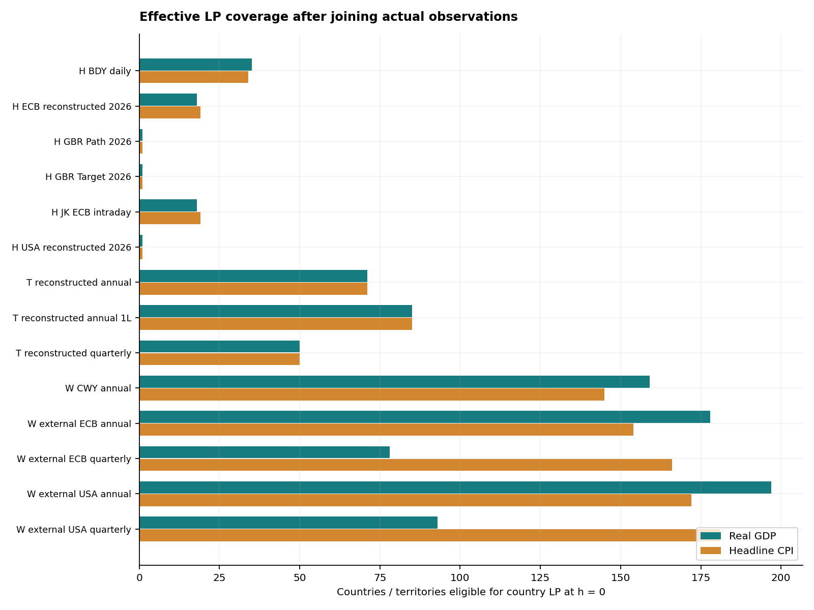

# Global Monetary Transmission Atlas — empirical notebook

Snapshot: **22 November 2026**. Real data and executed Local Projections; exploratory results, not a finished paper.

## Executed work

Baseline specifications attempted: **46,628**; estimated: **35,330**. Four one-characteristic chunks: **E01, F01, F04, R01**; specifications attempted: **56,286**; estimated: **31,350**. Exclusions, null results, common-shock absorption and failures are retained in the attempt records. Counts include prespecified horizons, groups and sensitivity specifications; they are not counts of independent scientific discoveries.

Raw policy/discount/refinancing rates cover **149 countries and territories**. Country coverage is different from independent monetary authority coverage. The worldwide external-Fed experiment is explicitly a separate spillover design; it does not fill gaps in domestic shock identification.

## What is genuinely current

USMPD raw event observations reach **28 October 2026**. The PCA factor was independently reproduced with maximum absolute error 1.53e-16, followed by an explicitly labelled JK-style monetary/information decomposition. The current EA-EMPD contains meetings through **11 June 2026** and speeches through **30 June 2026**. The old JK method was first reproduced on the old raw workbook (maximum monthly error 8.56e-9), then re-estimated on the current meeting observations. UKMPD official target/path factors reach **30 April 2026** and stay separate from the other instruments.

The newest-named BDY download still ends in 2022. CWY annual observations end in 2019 and mix six identification classes; approximately 60% of their country-year observations inherit anchor shocks. Actual country-year sources are saved. Annual and quarterly Taylor-rule reconstructions extend history using observed IMF/BIS policy rates and genuine macro observations. They are weaker-identification innovations, not exogenous market surprises. Their first-stage uncertainty is not included in the LP HAC standard errors.

## Effective country LP coverage

Eligibility requires at least 20 annual or 40 quarterly observations, sufficient nonzero shock variation and full rank. Not every downloaded macro observation satisfies these requirements.

| universe                  | frequency   |   raw_shock_countries |   issuers |   gdp_eligible |   cpi_eligible | last   |
|:--------------------------|:------------|----------------------:|----------:|---------------:|---------------:|:-------|
| H_BDY_daily               | Q           |                    38 |        20 |             35 |             34 | 2022Q3 |
| H_ECB_reconstructed_2026  | Q           |                    21 |         1 |             18 |             19 | 2026Q2 |
| H_GBR_Path_2026           | Q           |                     1 |         1 |              1 |              1 | 2026Q1 |
| H_GBR_Target_2026         | Q           |                     1 |         1 |              1 |              1 | 2026Q1 |
| H_JK_ECB_intraday         | Q           |                    20 |         1 |             18 |             19 | 2025Q3 |
| H_USA_reconstructed_2026  | Q           |                     1 |         1 |              1 |              1 | 2026Q3 |
| T_reconstructed_annual    | A           |                    71 |        71 |             71 |             71 | 2025   |
| T_reconstructed_annual_1L | A           |                    85 |        85 |             85 |             85 | 2025   |
| T_reconstructed_quarterly | Q           |                    50 |        50 |             50 |             50 | 2026Q3 |
| W_CWY_annual              | A           |                   175 |        89 |            159 |            145 | 2019   |
| W_external_ECB_annual     | A           |                   206 |         1 |            178 |            154 | 2025   |
| W_external_ECB_quarterly  | Q           |                   179 |         1 |             78 |            166 | 2026Q2 |
| W_external_USA_annual     | A           |                   216 |         1 |            197 |            172 | 2025   |
| W_external_USA_quarterly  | Q           |                   189 |         1 |             93 |            181 | 2026Q3 |

## One structural characteristic at a time

The LP has shock, shock × Z, lagged Z and one lag of outcome growth, with country/calendar effects where identified and seasonality where needed. Annual characteristics retain annual observation dates and enter quarterly equations only as prior-calendar-year exposure states. Annual GDP/CPI are never interpolated into quarters. Quarterly CPI averages require three observed months.

The four executed chunks concern general-government debt/GDP (F01), domestic sovereign creditors outside the central bank/GDP (F04), principal refinancing within one year (R01), and net energy imports/energy use (E01). F01/F04 scale Z by 10 percentage points of GDP; R01 by a 0.10 portfolio share; E01 by 10 percentage points of energy use. Source portfolios and definitions are recorded. Remaining registry items are unstarted.

## Global interactions at prespecified horizons

These are two-year or eight-quarter interactions. Positive gamma means a higher response at higher Z; it is not an expansionary total response. Annual country-SD units and event basis-point units are different estimands.

| chunk   | universe                  | outcome   |   horizon |    estimate |        se |      p_raw |   p_block_wild_informational |     n |   n_countries |   n_issuers |
|:--------|:--------------------------|:----------|----------:|------------:|----------:|-----------:|-----------------------------:|------:|--------------:|------------:|
| E01     | H_BDY_daily               | gdp       |         8 | -0.00085507 | 0.0024574 | 0.7287     |                       0.73   |  2718 |            38 |          20 |
| E01     | H_BDY_daily               | cpi       |         8 |  0.0002108  | 0.0035622 | 0.95294    |                       0.9625 |  2581 |            36 |          18 |
| E01     | H_ECB_reconstructed_2026  | gdp       |         8 |  0.0024761  | 0.028025  | 0.92978    |                       0.915  |  1427 |            19 |           1 |
| E01     | H_ECB_reconstructed_2026  | cpi       |         8 | -0.019376   | 0.016671  | 0.24791    |                       0.2275 |  1538 |            19 |           1 |
| E01     | T_reconstructed_annual_1L | gdp       |         2 | -0.028688   | 0.02629   | 0.28333    |                       0.6975 |  1635 |            70 |          70 |
| E01     | T_reconstructed_annual_1L | cpi       |         2 | -0.0071863  | 0.021888  | 0.7448     |                       0.7275 |  1626 |            70 |          70 |
| E01     | T_reconstructed_quarterly | gdp       |         8 |  0.0020722  | 0.00279   | 0.45896    |                       0.4225 |  4027 |            46 |          46 |
| E01     | T_reconstructed_quarterly | cpi       |         8 | -0.001278   | 0.0043049 | 0.76703    |                       0.7475 |  4136 |            46 |          46 |
| E01     | W_CWY_annual              | gdp       |         2 | -0.0013369  | 0.0085225 | 0.87648    |                       0.91   |  3201 |           126 |          80 |
| E01     | W_CWY_annual              | cpi       |         2 |  0.045395   | 0.027203  | 0.10631    |                       0.2275 |  3036 |           124 |          80 |
| E01     | W_external_USA_annual     | gdp       |         2 | -0.028553   | 0.02939   | 0.34099    |                       0.245  |  3246 |           136 |           1 |
| E01     | W_external_USA_annual     | cpi       |         2 | -0.0041678  | 0.031     | 0.89417    |                       0.885  |  3057 |           133 |           1 |
| E01     | W_external_USA_quarterly  | gdp       |         8 |  0.01696    | 0.014226  | 0.23585    |                       0.295  |  7142 |            91 |           1 |
| E01     | W_external_USA_quarterly  | cpi       |         8 |  0.017089   | 0.012686  | 0.18084    |                       0.245  | 12790 |           137 |           1 |
| F01     | H_BDY_daily               | gdp       |         8 |  0.10913    | 0.032047  | 0.00099302 |                       0.045  |  2722 |            38 |          20 |
| F01     | H_BDY_daily               | cpi       |         8 |  0.015535   | 0.024275  | 0.52386    |                       0.5225 |  2585 |            36 |          18 |
| F01     | H_ECB_reconstructed_2026  | gdp       |         8 |  0.09668    | 0.084076  | 0.2531     |                       0.235  |  1479 |            19 |           1 |
| F01     | H_ECB_reconstructed_2026  | cpi       |         8 |  0.012941   | 0.021856  | 0.55512    |                       0.555  |  1593 |            19 |           1 |
| F01     | T_reconstructed_annual_1L | gdp       |         2 | -0.040753   | 0.062097  | 0.51522    |                       0.6825 |  1987 |            84 |          84 |
| F01     | T_reconstructed_annual_1L | cpi       |         2 |  0.031076   | 0.055771  | 0.58035    |                       0.4925 |  1969 |            84 |          84 |
| F01     | T_reconstructed_quarterly | gdp       |         8 |  0.03663    | 0.032863  | 0.26655    |                       0.3125 |  4317 |            50 |          50 |
| F01     | T_reconstructed_quarterly | cpi       |         8 |  0.037194   | 0.057203  | 0.51642    |                       0.825  |  4439 |            50 |          50 |
| F01     | W_CWY_annual              | gdp       |         2 | -0.063127   | 0.077535  | 0.42062    |                       0.495  |  3827 |           165 |          87 |
| F01     | W_CWY_annual              | cpi       |         2 | -0.010745   | 0.11084   | 0.92328    |                       0.9075 |  3649 |           163 |          87 |
| F01     | W_external_USA_annual     | gdp       |         2 | -0.13265    | 0.046012  | 0.0081829  |                       0.12   |  4411 |           188 |           1 |
| F01     | W_external_USA_annual     | cpi       |         2 | -0.27149    | 0.20728   | 0.20266    |                       0.09   |  4119 |           181 |           1 |
| F01     | W_external_USA_quarterly  | gdp       |         8 | -0.10917    | 0.065607  | 0.099071   |                       0.05   |  7749 |           102 |           1 |
| F01     | W_external_USA_quarterly  | cpi       |         8 | -0.071645   | 0.081122  | 0.37914    |                       0.4425 | 16668 |           176 |           1 |
| F04     | H_BDY_daily               | gdp       |         8 |  0.041142   | 0.035413  | 0.24843    |                       0.35   |  1439 |            20 |          16 |
| F04     | H_BDY_daily               | cpi       |         8 |  0.019241   | 0.046104  | 0.67744    |                       0.7625 |  1311 |            18 |          14 |
| F04     | H_ECB_reconstructed_2026  | gdp       |         8 |  0.16438    | 0.12876   | 0.20487    |                       0.2525 |   497 |            11 |           1 |
| F04     | H_ECB_reconstructed_2026  | cpi       |         8 | -0.13208    | 0.052494  | 0.013458   |                       0.0225 |   597 |            14 |           1 |
| F04     | T_reconstructed_annual_1L | gdp       |         2 |  0.074799   | 0.10072   | 0.46293    |                       0.4675 |   811 |            40 |          40 |
| F04     | T_reconstructed_annual_1L | cpi       |         2 | -0.30733    | 0.14222   | 0.038052   |                       0.2075 |   810 |            40 |          40 |
| F04     | T_reconstructed_quarterly | gdp       |         8 | -0.02785    | 0.033276  | 0.40408    |                       0.4525 |  2363 |            33 |          33 |
| F04     | T_reconstructed_quarterly | cpi       |         8 | -0.051959   | 0.063093  | 0.41162    |                       0.305  |  2398 |            33 |          33 |
| F04     | W_CWY_annual              | gdp       |         2 | -0.14449    | 0.07544   | 0.065362   |                       0.18   |  1476 |            72 |          51 |
| F04     | W_CWY_annual              | cpi       |         2 |  0.11542    | 0.10909   | 0.29875    |                       0.3    |  1416 |            71 |          51 |
| F04     | W_external_USA_annual     | gdp       |         2 | -0.16273    | 0.059764  | 0.011867   |                       0.07   |  1508 |            75 |           1 |
| F04     | W_external_USA_annual     | cpi       |         2 | -0.07697    | 0.12284   | 0.53685    |                       0.5975 |  1446 |            73 |           1 |
| F04     | W_external_USA_quarterly  | gdp       |         8 | -0.4129     | 0.31667   | 0.19513    |                       0.155  |  3744 |            65 |           1 |
| F04     | W_external_USA_quarterly  | cpi       |         8 |  0.21665    | 0.12619   | 0.08893    |                       0.03   |  5969 |            86 |           1 |
| R01     | H_BDY_daily               | gdp       |         8 |  0.048868   | 0.074397  | 0.51297    |                       0.4775 |  2132 |            31 |          18 |
| R01     | H_BDY_daily               | cpi       |         8 | -0.10588    | 0.1126    | 0.3496     |                       0.5075 |  1971 |            29 |          16 |
| R01     | H_ECB_reconstructed_2026  | gdp       |         8 |  0.41865    | 0.54481   | 0.44416    |                       0.635  |  1081 |            15 |           1 |
| R01     | H_ECB_reconstructed_2026  | cpi       |         8 |  0.44498    | 0.20093   | 0.029061   |                       0.0975 |  1113 |            15 |           1 |
| R01     | T_reconstructed_annual_1L | gdp       |         2 | -0.025911   | 0.087831  | 0.77025    |                       0.7275 |   405 |            19 |          19 |
| R01     | T_reconstructed_annual_1L | cpi       |         2 | -0.2292     | 0.17981   | 0.21329    |                       0.28   |   405 |            19 |          19 |
| R01     | T_reconstructed_quarterly | gdp       |         8 | -0.34748    | 0.20522   | 0.093174   |                       0.09   |  1479 |            22 |          22 |
| R01     | T_reconstructed_quarterly | cpi       |         8 | -0.017437   | 0.20539   | 0.93249    |                       0.915  |  1522 |            22 |          22 |
| R01     | W_CWY_annual              | gdp       |         2 | -0.13048    | 0.17544   | 0.46456    |                       0.4975 |   654 |            32 |          34 |
| R01     | W_CWY_annual              | cpi       |         2 | -0.11609    | 0.17933   | 0.5238     |                       0.4575 |   654 |            32 |          34 |
| R01     | W_external_USA_annual     | gdp       |         2 | -0.14706    | 0.19417   | 0.45618    |                       0.5675 |   675 |            33 |           1 |
| R01     | W_external_USA_annual     | cpi       |         2 |  0.10673    | 0.15586   | 0.50004    |                       0.5975 |   675 |            33 |           1 |
| R01     | W_external_USA_quarterly  | gdp       |         8 | -0.1294     | 0.15554   | 0.40734    |                       0.5775 |  2771 |            39 |           1 |
| R01     | W_external_USA_quarterly  | cpi       |         8 |  0.099      | 0.17467   | 0.57206    |                       0.6225 |  2746 |            38 |           1 |

Raw HAC p-values remain visible. The calendar-block wild diagnostic can materially weaken an apparently small raw p-value; few time blocks limit this diagnostic too. BH q-values are provided as information in coefficient files. None selects the reported model or deletes a null.

## What the first chunks reveal

- **Debt/GDP:** BDY daily-event identification shows a positive GDP interaction at eight quarters (approximately +0.109 percentage point per 10-bp factor and +10 pp debt/GDP; raw p approximately 0.001; block-wild p approximately 0.045). This does not establish an expansionary total response. The broad CWY and current ECB reconstructions do not provide uniform confirmation.
- **Creditor residence:** the single-characteristic specification does not provide a uniform positive income-channel result. The current ECB price interaction can be negative, while output estimates vary with horizon and the set of supported countries. This simpler specification is not the old repository's creditor reallocation contrast conditional on other debt stocks.
- **Refinancing:** the current ECB price interaction at eight quarters is +0.445 per 10-bp factor and +10 pp of principal due within one year (raw p 0.029; calendar-block wild p 0.098; 15 countries sharing one issuer). The weaker block diagnostic and null BDY/CWY comparisons prevent a robust inflationary-channel conclusion.
- **Net energy imports:** the prespecified two-year/eight-quarter GDP and CPI global interactions are insignificant at 5% in all seven supported comparison families. This is an informative null in this simple model, not evidence that energy structure never matters.

The exact fixed-exposure conditional responses, with covariance propagated from beta and gamma, are in `results/conditional_response_grid.csv`. When time effects absorb a common shock main effect, only relative exposure responses are identified; no absolute conditional response is invented.

## Country heterogeneity

`results/baseline/dispersion_block_bootstrap.csv` compares observed cross-country dispersion with the sampling dispersion generated by shared calendar-block perturbations of the actual country LP scores. This retains common currency-union innovations and correlated global residuals. A simple variance-minus-average-standard-error calculation is only descriptive. Country means, medians, sign changes and peak horizons are saved. Peak timing is selected descriptively and does not receive an unadjusted significance claim.

At eight quarters the approximate common-response dispersion diagnostic gives p = 0.118 for BDY GDP and p = 0.460 for the current ECB GDP reconstruction. The CWY annual GDP comparison at two years gives p = 0.060. Thus the apparent spread of country point estimates is not, by itself, decisive evidence of structural heterogeneity beyond sampling noise. These diagnostics use limited calendar blocks and are not formal proof of homogeneity either.

`figures/country_IRFs.pdf` contains **203 country/territory pages**, with real-GDP and CPI responses at native annual and quarterly frequencies where eligible. The index names the exact selected shock family for each country/frequency. Other estimated families and every horizon remain in the coefficient files. Positive point estimates are never automatically labelled expansionary.

## Files for checking the findings

- [Country IRF book](figures/country_IRFs.pdf) and [page index](figures/country_IRF_index.csv).
- [F01 debt](notebooks/chunk_F01.md), [F04 ownership](notebooks/chunk_F04.md), [R01 refinancing](notebooks/chunk_R01.md), [E01 energy](notebooks/chunk_E01.md).
- [Numerical validation](audit/numerical_validation.json), [fresh shock endpoints](audit/fresh_shocks_actual_endpoints.csv), [worldwide country gaps](audit/worldwide_country_gap_inventory.csv).
- Coefficient files retain raw p-values, standard errors, intervals, dates, N, country/issuer counts, identification status and informational q-values. Compact permanent model records also retain the complete economic coefficient covariance and diagnostic metadata. Large internal score arrays/sample-key lists can be regenerated from saved panels, code and sample-key hashes.

## Completed, partial and unstarted

Completed: worldwide source audit and macro expansion; specified shock reconstructions and their numerical overlap checks; the saved baseline universe; four named core chunks, including country/state, panel/group, separate external-Fed and supported early-exposure association diagnostics.

Partial: adding genuinely quarterly CPI histories for economies with short monthly reporting (notably Australia/New Zealand), exhaustive domestic shock identification for every state, searches of every national central-bank archive, current common-authority reaction rules outside the euro area, country-specific high-frequency/narrative replacements, fully harmonized sovereign portfolio definitions, generated-Taylor-shock bootstrap uncertainty, all requested institutional/regime comparisons, and every possible country/sensitivity graph.

Unstarted: the rest of the structural-variable registry and the portion of the user's catalogue absent after the truncated F10 item. Public download failures are recorded; no observations are manufactured to close gaps. Unfinished tasks do not continue in the background.
